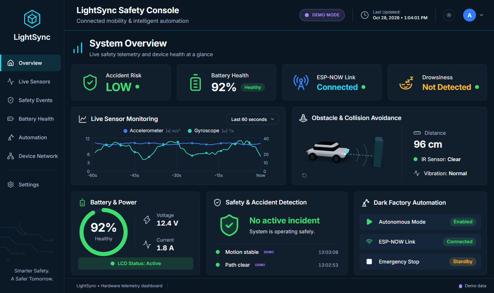
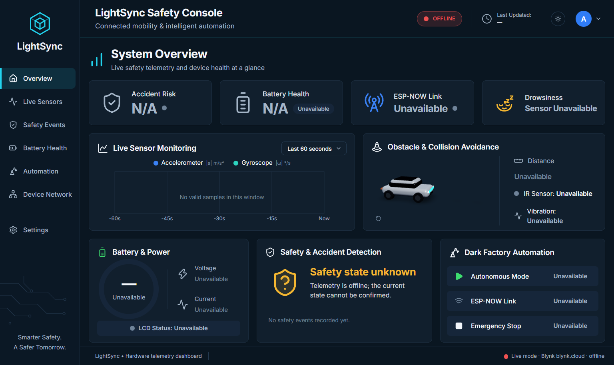

# Running LightSync Safety Console

This guide covers installing, starting, checking, testing and deploying the application, and **what to do when something goes wrong**.

For connecting real hardware through Blynk, see **[BLYNK_SETUP.md](BLYNK_SETUP.md)**.

---

## Contents

- [Quick start](#quick-start)
- [1. Prerequisites](#1-prerequisites)
- [2. First-time setup](#2-first-time-setup)
- [3. Start the application](#3-start-the-application)
- [4. Check that it works](#4-check-that-it-works)
- [5. Demo mode and live mode](#5-demo-mode-and-live-mode)
- [6. Stop the application](#6-stop-the-application)
- [7. Tests, lint and build](#7-tests-lint-and-build)
- [8. Production deployment](#8-production-deployment)
- [Troubleshooting](#troubleshooting)

---

## Quick start

You need **two terminals**, one for the backend and one for the frontend. Run all commands from the project folder (`lightsync/`).

**Windows (PowerShell)**

```powershell
Copy-Item .env.example .env
cd backend; python -m venv .venv; .venv\Scripts\python -m pip install -r requirements-dev.txt; cd ..
cd frontend; npm install; cd ..
```

Terminal 1, the backend:

```powershell
cd backend; .venv\Scripts\python -m uvicorn app.main:app --host 127.0.0.1 --port 8000
```

Terminal 2, the frontend:

```powershell
cd frontend; npm run dev
```

**macOS / Linux / Git Bash**

```bash
cp .env.example .env
(cd backend && python3 -m venv .venv && .venv/bin/python -m pip install -r requirements-dev.txt)
(cd frontend && npm install)
```

In Git Bash on Windows, use `.venv/Scripts/python` instead of `.venv/bin/python`.

Terminal 1:

```bash
cd backend && .venv/bin/python -m uvicorn app.main:app --host 127.0.0.1 --port 8000
```

Terminal 2:

```bash
cd frontend && npm run dev
```

Open **<http://localhost:5173>**. You should see the dashboard with a purple **DEMO MODE** badge in the header.

---

## 1. Prerequisites

| Tool | Version | Check with |
|---|---|---|
| Python | 3.11 or newer (tested with 3.13) | `python --version` (`py --version` on Windows) |
| Node.js | 20.19+ or 22.12+ (tested with 22.17) | `node --version` |
| npm | comes with Node.js | `npm --version` |
| Git | any recent version | `git --version` |
| Browser | recent Chrome, Edge, Firefox or Safari (WebGL for the 3D view) | |

You don't need Blynk, hardware or an internet connection for **demo mode**.

## 2. First-time setup

### 2.1 Get the code

```bash
git clone https://github.com/ashwin8332/LightSync.git
```

```bash
cd LightSync
```

### 2.2 Create your configuration file

```bash
cp .env.example .env
```

On PowerShell, use `Copy-Item .env.example .env`.

The defaults start in **demo mode**, so nothing needs editing yet. `.env` holds secrets later on and is git-ignored. Never commit it.

### 2.3 Install the backend (Python)

```bash
cd backend
python -m venv .venv
```

Then install the packages with the command for your system.

| System | Command |
|---|---|
| Windows (PowerShell) | `.venv\Scripts\python -m pip install -r requirements-dev.txt` |
| Git Bash | `.venv/Scripts/python -m pip install -r requirements-dev.txt` |
| macOS / Linux | `.venv/bin/python -m pip install -r requirements-dev.txt` |

You don't have to "activate" the virtual environment: calling `.venv\Scripts\python` (or `.venv/bin/python`) directly always uses the right one.

### 2.4 Install the frontend (Node.js)

```bash
cd frontend
npm install
```

## 3. Start the application

Start the **backend first**, then the frontend.

### 3.1 Backend (terminal 1)

```bash
cd backend
.venv/Scripts/python -m uvicorn app.main:app --host 127.0.0.1 --port 8000
```

On macOS or Linux, use `.venv/bin/python`.

It's ready when you see:

```
INFO:     Uvicorn running on http://127.0.0.1:8000 (Press CTRL+C to quit)
```

For auto-reload while editing backend code, add `--reload`.

### 3.2 Frontend (terminal 2)

```bash
cd frontend
npm run dev
```

It's ready when you see:

```
VITE vX.Y.Z  ready in … ms
➜  Local:   http://localhost:5173/
```

The frontend forwards every `/api/...` request to the backend at `http://127.0.0.1:8000`. If your backend runs elsewhere, set `LIGHTSYNC_BACKEND_URL` before `npm run dev`. On PowerShell:

```powershell
$env:LIGHTSYNC_BACKEND_URL="http://127.0.0.1:8010"
```

On macOS, Linux or Git Bash:

```bash
export LIGHTSYNC_BACKEND_URL=http://127.0.0.1:8010
```

### 3.3 Addresses

| What | URL |
|---|---|
| Dashboard | <http://localhost:5173> |
| Backend health check | <http://127.0.0.1:8000/api/health> |
| Interactive API docs (FastAPI) | <http://127.0.0.1:8000/docs> |
| Live telemetry stream (SSE) | <http://127.0.0.1:8000/api/telemetry/stream> |

## 4. Check that it works

1. **Backend health:**

   ```bash
   curl http://127.0.0.1:8000/api/health
   ```

   Expected:

   ```json
   {"status":"ok","version":"1.0.0","mode":"demo","connection":"demo","blynk_configured":false}
   ```

2. **Dashboard:** open <http://localhost:5173>. Within a few seconds you should see:
   - a purple **DEMO MODE** badge in the header and **Demo data** in the footer
   - the *Last Updated* time ticking every second
   - the sensor chart filling up from the right
   - the 3D car with sensor waves, and the distance changing

   

3. **Navigation:** every item in the left sidebar should open its page. The theme button (sun/moon) in the header switches light and dark mode.

4. **Browser console:** press F12, then open **Console**. There should be no red errors.

## 5. Demo mode and live mode

| | Demo mode | Live mode |
|---|---|---|
| Data source | built-in simulator (a repeating 90-second scenario) | your hardware, through Blynk Cloud |
| Needs | nothing | Blynk token and hardware ([BLYNK_SETUP.md](BLYNK_SETUP.md)) |
| Header badge | DEMO MODE (purple) | SYSTEM ONLINE / DATA STALE / OFFLINE |
| Labels | every value and event marked **Demo** | values marked **Hardware** |

To switch modes:

- **Permanently:** set `LIGHTSYNC_MODE=demo` or `LIGHTSYNC_MODE=live` in `.env`, then restart the backend.
- **For the current run only:** use **Settings → Data source → Switch to live / Switch to demo**.

Switching clears all charted samples and events, so demo and real data never mix. Live mode **never** falls back to demo data. Without a Blynk token it shows **OFFLINE**:



## 6. Stop the application

Press **Ctrl + C** in each terminal. History and events are kept in memory, so they're cleared when the backend stops. That's by design.

## 7. Tests, lint and build

Backend tests (77 tests):

```bash
cd backend
.venv/Scripts/python -m pytest
```

Use `.venv/bin/python` on macOS or Linux.

Frontend tests, lint and production build:

```bash
cd frontend
npm test
npm run lint
npm run build
```

Expected results:

- pytest: `77 passed`
- Vitest: `Tests 19 passed`
- lint: exits without errors (a few React style warnings are expected and harmless)
- build: ends with `✓ built in …`

The same checks run on GitHub for every push (`.github/workflows/ci.yml`).

## 8. Production deployment

1. **Build the frontend:**

   ```bash
   cd frontend
   npm run build
   ```

   This creates static files in `frontend/dist/`.

2. **Run the backend** without `--reload`. Listen on all interfaces only if a reverse proxy sits in front of it:

   ```bash
   cd backend
   .venv/bin/python -m uvicorn app.main:app --host 127.0.0.1 --port 8000
   ```

3. **Serve both through one web server.** `frontend/dist/` serves as static files, and `/api` is forwarded to the backend. Example for nginx:

   ```nginx
   server {
       listen 80;
       root /srv/lightsync/frontend/dist;

       location /api/ {
           proxy_pass http://127.0.0.1:8000;
           proxy_http_version 1.1;
           proxy_set_header Connection "";
           proxy_buffering off;          # required for the live SSE stream
           proxy_read_timeout 1h;
       }

       location / {
           try_files $uri /index.html;   # client-side routes such as /settings
       }
   }
   ```

4. If the dashboard is served from a **different origin** than the API, list that origin in `LIGHTSYNC_CORS_ORIGINS` in `.env`.
5. Set `LIGHTSYNC_API_KEY` before exposing the dashboard. Use HTTPS so the operator key isn't sent in plain text.

You can also preview the production build locally:

```bash
cd frontend
npm run build
npm run preview
```

Then open <http://localhost:4173>. The backend must still be running.

---

## Troubleshooting

Work through the section for the stage that fails. The most useful places to look are:

- the **backend terminal**: log lines look like `level=WARNING logger=lightsync.blynk msg="..."`
- the **frontend terminal**: Vite errors and proxy errors
- the **browser console**: F12 → Console
- the dashboard's **Settings** page (configuration warnings appear at the top)
- the dashboard's **Device Network** page (Blynk status and last error)
- `http://127.0.0.1:8000/api/health`

### A. Installation problems

| Error | Fix |
|---|---|
| `python` is not recognized, or the Microsoft Store opens | Install Python from <https://www.python.org/downloads/> and tick **Add python.exe to PATH**, or use `py -3` instead of `python`. |
| `Activate.ps1 cannot be loaded because running scripts is disabled` | You don't need to activate the venv; call `.venv\Scripts\python` directly as shown above. |
| `pip` SSL or proxy errors | You're behind a proxy: set `HTTPS_PROXY`, or run `pip install --proxy http://host:port ...`. |
| `npm ERR! ERESOLVE unable to resolve dependency tree` | Run `npm ci`, which installs exactly what `package-lock.json` specifies. Don't mix package managers. |
| `EPERM`, `EBUSY` or `operation not permitted` during `npm install` on Windows | Usually OneDrive or an antivirus locking files. Pause OneDrive syncing (or move the project out of OneDrive), close editors, delete `frontend/node_modules`, then run `npm install` again. |
| `Vite requires Node.js version 20.19+ or 22.12+` / `SyntaxError: Unexpected token` from Vite | Your Node.js is too old. Install the current LTS from <https://nodejs.org>. |

### B. The backend doesn't start

| Error | Fix |
|---|---|
| `No module named uvicorn` / `No module named fastapi` | Packages aren't installed in this venv. Run `.venv\Scripts\python -m pip install -r requirements-dev.txt` from `backend/`. |
| `ModuleNotFoundError: No module named 'app'` | You're not in `backend/`. Either `cd backend` first, or run from the project root with `--app-dir backend`. |
| `[Errno 10048] ... only one usage of each socket address` (Windows) / `Address already in use` | Port 8000 is taken. See [freeing a port](#freeing-a-port), or start on another port (`--port 8010`) and set `LIGHTSYNC_BACKEND_URL` for the frontend. |
| `ValidationError ... lightsync_mode Input should be 'demo' or 'live'` | Fix the typo in `.env`. Only `demo` and `live` are allowed. |
| `ValidationError ... BLYNK_SERVER must be a bare host name` | Write `BLYNK_SERVER=blynk.cloud`, with no `https://` and no `/`. |
| `ValidationError ... obstacle_critical_cm must be smaller than obstacle_warning_cm` | Fix the `THRESHOLD_OBSTACLE_*` values in `.env`. |
| Starts, but **Settings** shows “Pin mapping error … Falling back to default pins” | A `PIN_*` value in `.env` is invalid (only `V0`–`V255` or `none`) or used twice. Correct it and restart. |
| Changes to `.env` have no effect | `.env` must be in the project root or in `backend/`, and the backend must be restarted. Environment variables already set in your terminal take priority over `.env`. |

### C. The frontend doesn't start or shows a blank page

| Symptom | Fix |
|---|---|
| `Port 5173 is in use, trying another one...` | Not an error: Vite picked another port. Open the URL it prints. |
| `[vite] http proxy error: /api/... ECONNREFUSED` | The backend isn't running, or it's on another port. Start it (step 3.1), or set `LIGHTSYNC_BACKEND_URL`. |
| Blank white page | Open the browser console (F12). Hard-refresh with Ctrl + Shift + R. If it persists, stop Vite, delete `frontend/node_modules/.vite`, and run `npm run dev` again. |
| `Failed to fetch dynamically imported module` after an update | The browser cached old files. Hard-refresh the page. |
| Page shows only “Loading…” | A page chunk is still downloading or failed to download. Check the frontend terminal and the browser console for errors. |

### D. The dashboard runs but something looks wrong

| What you see | Meaning and fix |
|---|---|
| Header **OFFLINE**, tooltip “Dashboard backend is unreachable” | The browser can't reach the backend. Make sure terminal 1 is still running and `http://127.0.0.1:8000/api/health` responds. |
| Header **OFFLINE** – “BLYNK_TOKEN is not configured on the server” | You're in live mode without a Blynk token. Either follow [BLYNK_SETUP.md](BLYNK_SETUP.md) or switch back to demo (**Settings → Switch to demo**, or `LIGHTSYNC_MODE=demo`). |
| Header **OFFLINE** / **DATA STALE** with another Blynk message | See [BLYNK_SETUP.md → troubleshooting](BLYNK_SETUP.md#11-blynk-troubleshooting). |
| Header **DATA STALE** – “No update from the backend for N s” | The live connection stalled. The dashboard reconnects automatically and falls back to polling every 3 s. If it continues, a proxy or antivirus may be blocking `/api/telemetry/stream` (Server-Sent Events). |
| Header stays **CONNECTING** | The first data hasn't arrived. Check the backend terminal for errors. |
| Cards show **Unavailable** / **N/A** | That value isn't published by the hardware or isn't mapped to a pin. This is intentional: the dashboard never invents values. |
| Chart says “No valid samples in this window” | The backend has just started, or telemetry is stale or offline (stale periods aren't charted). Wait, or pick a longer window. |
| 3D car replaced by a flat drawing: “WebGL unavailable” or “3D view failed to load” | Your browser has WebGL disabled. Turn on **hardware acceleration** in the browser settings, or ignore it, because the 2D view shows the same information. |
| Wrong theme, or theme doesn't stick | Pick **Settings → Appearance** (System, Light or Dark). The choice is saved in this browser. |
| History and events disappeared | The backend restarted, or the mode was switched. History is kept in memory only. |

### E. Controls and settings errors

| Message | Fix |
|---|---|
| “LIGHTSYNC_API_KEY must be configured on the server before operator actions are allowed in live mode” (403) | Set `LIGHTSYNC_API_KEY` in `.env` and restart the backend. |
| **Switch to demo** in Settings fails with the 403 message above | In live mode, every operator action, including switching modes, needs the key. Either set `LIGHTSYNC_API_KEY`, or set `LIGHTSYNC_MODE=demo` in `.env` and restart the backend (it always starts in the `.env` mode). |
| “Missing or invalid operator key” (401) | Enter the same value as `LIGHTSYNC_API_KEY` under **Settings → Operator access**. It's kept only for this browser tab session. |
| “COMMANDS_ENABLED is false on the server” / “PIN_CMD_… is not set” | Remote commands aren't configured. See [BLYNK_SETUP.md, section 9](BLYNK_SETUP.md#9-enable-remote-commands-optional). |
| “Too many requests; slow down” (429) | Wait a minute. Commands are limited to 10 per minute and settings changes to 30 per minute. |
| Command result **unconfirmed** | The request reached Blynk but the hardware didn't report the new state in time. Check the gateway firmware. |
| Controls are greyed out | Telemetry isn't live (stale or offline), the state isn't published, or commands aren't enabled. Hover over the control to see the reason. |

### F. Test failures

| Error | Fix |
|---|---|
| `pytest: command not found` | Use `.venv\Scripts\python -m pytest` from `backend/`. |
| `ReferenceError: document is not defined` in frontend tests | Run tests with `npm test` (it uses the configured jsdom environment), not by calling `vitest` from another folder. |
| Tests pass locally but fail on GitHub | Open the failed job under the repository's **Actions** tab. CI uses Python 3.12 and Node 22. |

### Freeing a port

**Windows (PowerShell or cmd):**

```powershell
netstat -ano | findstr :8000
```

The last column is the process ID (PID). End that process:

```powershell
taskkill /PID <PID> /F
```

**macOS / Linux:**

```bash
lsof -i :8000
```

```bash
kill <PID>
```

Only end processes you recognise. Alternatively, run LightSync on a different port.

### Still stuck?

Collect the following and open an issue in the repository:

- the output of `http://127.0.0.1:8000/api/health`
- the last ~30 lines of the backend terminal
- any red errors from the browser console
- a screenshot of the **Settings** page warnings

**Remove `BLYNK_TOKEN` and `LIGHTSYNC_API_KEY` values before sharing anything.** The backend never prints them, but your `.env` contains them.
